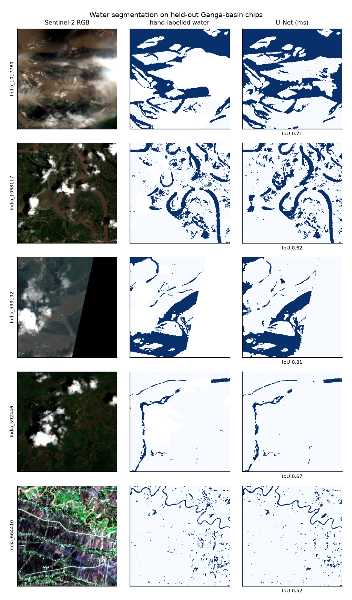

# Deep Learning Notebooks and Projects

This repository holds my deep learning coursework and portfolio projects. It starts with a single neuron in PyTorch and moves through feed-forward networks, CNNs and recurrent networks to retrieval-augmented generation (RAG) with LLM APIs. Three applied projects close it out: handwriting recognition, sign language recognition and a flood-risk system.

Most of the code is PyTorch in Jupyter notebooks. The ASL project uses TensorFlow/Keras, and the RAG work uses LangChain. The largest project, **River Flood Sense AI**, is a script-based pipeline with a Streamlit app.

> Results below are copied from the outputs saved in each notebook or report file. Nothing was re-run while this README was written. Notebooks whose runs were interrupted or never executed are marked as such.

---

## Contents

- [Repository structure](#repository-structure)
- [Topics covered](#topics-covered)
- [Projects](#projects)
- [Results summary](#results-summary)
- [Technologies](#technologies)
- [Setup](#setup)
- [Running the notebooks and scripts](#running-the-notebooks-and-scripts)
- [Datasets and licensing](#datasets-and-licensing)
- [Key learning outcomes](#key-learning-outcomes)
- [Current status and future work](#current-status-and-future-work)

---

## Repository structure

```
.
├── 01_fundamentals/                  Single neuron in PyTorch; OpenCV image basics
├── 02_ann/
│   ├── classification/               MLP classifier: Date Fruit dataset (7 classes)
│   └── regression/                   MLP regressor: power-plant energy output
├── 03_cnn/                           CNN image classifier: CIFAR-10
├── 04_rnn_nlp/                       IMDB text preprocessing; RNN/LSTM/GRU/BiLSTM/attention/DistilBERT notebook
├── 05_rag_llm/                       RAG pipeline (LangChain + Chroma) and LLM API experiments
├── projects/
│   ├── 01_handwritten_character_recognition/   EMNIST letters/digits + HASYv2 math symbols (PyTorch)
│   ├── 02_asl_sign_language_recognition/       ASL hand signs, 36 classes (TensorFlow/Keras)
│   └── 03_river_flood_sense_ai/                Satellite U-Net + gradient-boosted flood forecaster + Streamlit app
├── archive/                          Scratch notebooks and recovered earlier runs (see archive/README.md)
├── requirements.txt                  Dependencies for folders 01–05 and projects 01–02
└── .gitignore
```

Every folder has its own `README.md` describing its contents. Notebooks are numbered in the suggested reading order. `_reimplementation` marks a second notebook in which I rewrote the same model from scratch as practice.

---

## Topics covered

| Folder | Topic | Notebooks |
|---|---|---|
| [`01_fundamentals`](01_fundamentals/) | A single `nn.Linear` neuron, checked by hand (`w·x + b`); reading images and grayscale conversion with OpenCV | 2 |
| [`02_ann`](02_ann/) | Feed-forward networks for multi-class classification and regression; `DataLoader` training loops; validation tracking and best-model checkpointing | 4 |
| [`03_cnn`](03_cnn/) | Convolutional networks (Conv → ReLU → MaxPool ×3) on CIFAR-10 | 2 |
| [`04_rnn_nlp`](04_rnn_nlp/) | Text cleaning (regex, stop words, stemming); sequence models: vanilla RNN, LSTM, GRU, BiLSTM, additive attention, DistilBERT fine-tuning | 2 |
| [`05_rag_llm`](05_rag_llm/) | Document loading, chunking, sentence-transformer embeddings, Chroma vector store, retrieval, LLM answer generation (OpenAI, Groq); chat, vision and image-generation APIs | 3 |

---

## Projects

### 1. Handwritten character recognition ([`projects/01_handwritten_character_recognition`](projects/01_handwritten_character_recognition/))
Two PyTorch CNNs with two conv blocks each:
- **EMNIST Balanced**: 47 classes of handwritten digits and letters, trained with rotation augmentation.
- **HASYv2 math symbols**: a 19-class subset (digits, `+ - × ÷ √ π x y z`) of the 369-symbol HASYv2 dataset, with a stratified validation split, a confusion matrix and the trained weights saved to `HASYv2_math_CNN.pth`.

### 2. ASL sign language recognition ([`projects/02_asl_sign_language_recognition`](projects/02_asl_sign_language_recognition/))
Classifies static ASL hand signs: the digits 0–9 and letters a–z, 36 classes and 2,515 images. There are two TensorFlow/Keras notebooks:
- a **baseline CNN** using `ImageDataGenerator`, with a classification report, a confusion matrix and an `ipywidgets` upload-and-predict cell;
- an **augmented CNN** with BatchNorm, Keras augmentation layers, a stratified 70/15/15 split, `ModelCheckpoint` and `ReduceLROnPlateau`.

### 3. River Flood Sense AI ([`projects/03_river_flood_sense_ai`](projects/03_river_flood_sense_ai/))
Flood-risk assessment for 20 West Bengal river gauges, built as a reproducible script pipeline (`run_all.py`) with a Streamlit app. It has three parts:
- a **U-Net** for water segmentation on Sentinel-2 imagery (Sen1Floods11), with multispectral and RGB-only variants;
- a **gradient-boosting** forecaster that predicts a bankfull breach within 3 days from ERA5 weather and GloFAS discharge, using a temporal train/validation/test split;
- a **fusion** model that combines the two.

The project README documents its data sources, its evaluation and its limitations, including a negative result where fusion did not beat the image-only model.

<p align="center">
  
</p>

---

## Results summary

All values are taken from saved notebook outputs or report files in this repository.

| Section | Model / task | Reported result | Notes |
|---|---|---|---|
| `02_ann/classification` | MLP, Date Fruit, 7 classes | Test accuracy **95.0%** | 180 test samples |
| `02_ann/regression` | MLP, power-plant energy output | Test MSE **18.87**, R² **0.934** | Reimplementation: MSE 19.57, R² 0.932 |
| `03_cnn` | CNN, CIFAR-10 | Test accuracy **75.4%** after 10 epochs | From an earlier completed run saved in [`archive/recovered_checkpoints`](archive/recovered_checkpoints/). The current notebook's last run was interrupted. |
| `projects/01` | CNN, EMNIST Balanced (47 classes) | Test accuracy **86.97%** | 5 epochs |
| `projects/01` | CNN, HASYv2 (19 math symbols) | Test accuracy **95.20%** | 583 test images, fold 1 |
| `projects/02` | Baseline CNN, ASL (36 classes) | Validation accuracy **87.28%** | 503 held-out images; no separate test split |
| `projects/03` | U-Net, multispectral (7 channels) | Test water IoU **0.735**, F1 **0.847** | From `reports/cnn_metrics_ms.json` |
| `projects/03` | Gradient boosting, 3-day flood forecast | Test ROC-AUC **0.989**, PR-AUC **0.862** | Test window 2023–2026; persistence baseline PR-AUC 0.794 |

These notebooks have no reported metric: `04_rnn_nlp/02` (never executed), `projects/02/02_asl_cnn_augmented` (outputs not saved, though a trained model file exists), and the CIFAR-10 reimplementation (stopped after 1 epoch).

---

## Technologies

- **Language:** Python
- **Deep learning:** PyTorch, torchvision, TensorFlow / Keras, Hugging Face Transformers
- **Classical ML and data:** scikit-learn, NumPy, pandas
- **NLP:** NLTK, sentence-transformers
- **LLM / RAG:** LangChain (core, community, text-splitters, OpenAI, Groq), ChromaDB, OpenAI and Groq SDKs
- **Vision and geospatial:** OpenCV, Pillow, tifffile
- **Visualisation and apps:** Matplotlib, seaborn, ipywidgets, Streamlit
- **Environment:** Jupyter, Anaconda and venv

---

## Setup

### Python version
The notebooks were run in more than one environment. The interpreter versions recorded in the notebook metadata are:

| Where | Python |
|---|---|
| Most topic notebooks (Anaconda base) | 3.13 |
| TensorFlow ASL notebook | 3.11 |
| `projects/03_river_flood_sense_ai` | 3.14 |

Python **3.11** is the safest single choice, because TensorFlow is the most restrictive dependency. I have not tested the whole repository end to end in one environment.

### Install

```bash
git clone <this-repo-url>
cd <repo-folder>

python -m venv .venv
# Windows: .venv\Scripts\activate      macOS/Linux: source .venv/bin/activate

python -m pip install -r requirements.txt
```

Project 03 has its own dependency file. Install it from inside the project folder:

```bash
cd projects/03_river_flood_sense_ai
pip install -r requirements.txt
```

### API keys (05_rag_llm only)
API keys are read from environment variables and never stored in the notebooks:

| Variable | Used by |
|---|---|
| `GROQ_API_KEY` | `05_rag_llm/01_rag_pipeline.ipynb`, `05_rag_llm/03_llm_apis_groq_openai.ipynb` |
| `OPENAI_API_KEY` | `archive/openai_client_setup.ipynb` |
| `POLLINATIONS_API_KEY` | `05_rag_llm/03_llm_apis_groq_openai.ipynb` |

`05_rag_llm/02_rag_pipeline_llm_integration.ipynb` contains `"paste-your-api-key-here"` placeholders that you replace before running.

---

## Running the notebooks and scripts

All data paths are **relative to the notebook's own folder**. Start Jupyter from the repository root and open a notebook from the file browser. Jupyter and VS Code set the working directory to the notebook's folder automatically.

```bash
jupyter lab
```

| Section | Data you need first |
|---|---|
| `01_fundamentals`, `02_ann` | Nothing; the data files are included. |
| `03_cnn` | CIFAR-10 downloads automatically to `03_cnn/data/` (`download=True` in `01_cnn_cifar10.ipynb`). |
| `04_rnn_nlp` | Place `IMDB Dataset.csv` in `04_rnn_nlp/` (not committed; ~66 MB). |
| `05_rag_llm` | Create `05_rag_llm/data/Python.txt` and `05_rag_llm/data/pdfs/*.pdf` (not committed; see the folder README). |
| `projects/01` | EMNIST downloads automatically. Place `HASYv2.tar.bz2` in the project folder; the notebook extracts it. |
| `projects/02` | Place the image folders in `dataset/asl_dataset/<class>/`. |
| `projects/03` | `python run_all.py` downloads all data and trains every model (see the project README), then `streamlit run app/streamlit_app.py`. |

Trained model files are committed (`*.pt`, `*.pth`, `*.keras`, `*.pkl`), so you can run the inference notebook in project 03 without retraining.

---

## Datasets and licensing

Large datasets are not committed (see `.gitignore`). Where the source is not recorded anywhere in the repository, this table says so rather than guessing.

| Dataset | Used in | Source | Licence / terms | Provenance |
|---|---|---|---|---|
| CIFAR-10 | `03_cnn` | [Krizhevsky (2009)](https://www.cs.toronto.edu/~kriz/cifar.html), via `torchvision` | No formal licence; cite the technical report | Verified (downloaded in code) |
| EMNIST Balanced | `projects/01` | [Cohen et al. (2017), NIST](https://www.nist.gov/itl/products-and-services/emnist-dataset), via `torchvision` | See NIST page | Verified (downloaded in code) |
| HASYv2 | `projects/01` | Thoma (2017), [Zenodo 10.5281/zenodo.259444](https://doi.org/10.5281/zenodo.259444) | See the Zenodo record | Verified (bundled `README.txt`) |
| Sen1Floods11 | `projects/03` | [Cloud to Street / NASA IMPACT](https://github.com/cloudtostreet/Sen1Floods11) | CC BY 4.0 | Verified (download code) |
| GloFAS v4, ERA5 / ERA5-Land | `projects/03` | Copernicus, via [Open-Meteo](https://open-meteo.com/) | Open-Meteo data is CC BY 4.0 | Verified (download code) |
| Power-plant data (`powerplant_data.csv`) | `02_ann/regression` | Not recorded. Columns and row count (9,568) match the UCI *Combined Cycle Power Plant* dataset | UCI lists CC BY 4.0 | **Needs confirmation** |
| Date Fruit (`DateFruit_Dataset.csv`) | `02_ann/classification` | Not recorded. 898 rows × 34 features × 7 varieties, matching Koklu et al. (2021) | Check the original publication | **Needs confirmation** |
| IMDB reviews (`IMDB Dataset.csv`) | `04_rnn_nlp` | Not recorded. 50,000 rows with `review`/`sentiment`, consistent with the Large Movie Review Dataset (Maas et al., 2011) | Check the source you downloaded from | **Needs confirmation** |
| ASL hand signs (`asl_dataset`) | `projects/02` | Not recorded. File names (`hand1_b_bot_seg_1_cropped.jpeg`) suggest the Massey University 2D static hand gesture dataset | Unknown | **Unknown** |
| RAG source documents | `05_rag_llm` | Not included. Retrieval outputs show *Attention Is All You Need* (Vaswani et al., 2017) among the indexed PDFs | n/a | Files missing |

---

## Key learning outcomes

These are drawn from what the notebooks implement:

- Wrote PyTorch training and evaluation loops by hand: `Dataset` / `DataLoader`, loss functions, optimisers, `model.train()` / `model.eval()`, and saving the best checkpoint.
- Preprocessed tabular data (label encoding, train-only scaling) for classification and regression MLPs, and evaluated them with accuracy, MSE and R².
- Built CNNs for natural images, handwritten characters and hand signs in both PyTorch and Keras, including augmentation, BatchNorm, confusion matrices and per-class reports.
- Implemented a U-Net from scratch for segmentation with a combined BCE + Dice loss and IoU tracking.
- Prepared text for NLP (regex cleaning, tokenisation, stop words, stemming) and set up comparative RNN / LSTM / GRU / attention / transformer experiments.
- Built an end-to-end RAG pipeline: loading, chunking, embedding, vector storage, similarity retrieval and LLM generation.
- Structured a larger ML project as reproducible scripts with temporal validation, baselines and documented limitations.

---

## Current status and future work

**Complete, with saved results:** both ANN notebooks, both projects in `projects/01`, the ASL baseline, and `projects/03`.

**Incomplete, or needing a fresh run:**
- `03_cnn/01_cnn_cifar10.ipynb`: the last run was interrupted (`KeyboardInterrupt`). The completed earlier run is preserved in `archive/recovered_checkpoints/cnn_cifar10_completed_run.ipynb`.
- `03_cnn/02_cnn_cifar10_reimplementation.ipynb`: training stopped after 1 of 10 epochs, and there is no evaluation.
- `04_rnn_nlp/02_imdb_sentiment_rnn_lstm_gru_distilbert.ipynb`: written but never executed.
- `05_rag_llm/02_rag_pipeline_llm_integration.ipynb`: the saved run failed at an import (`langchain_community` was not installed). A complete earlier run is preserved in `archive/recovered_checkpoints/`.
- `05_rag_llm`: the source documents (`data/`) are not in the repository.
- `projects/02/02_asl_cnn_augmented.ipynb`: re-run to save outputs (training curves, test accuracy).

**Possible next steps:**
- Re-run the incomplete notebooks above and record their results.
- Record dataset sources and licences for the rows marked **Needs confirmation** or **Unknown** above.
